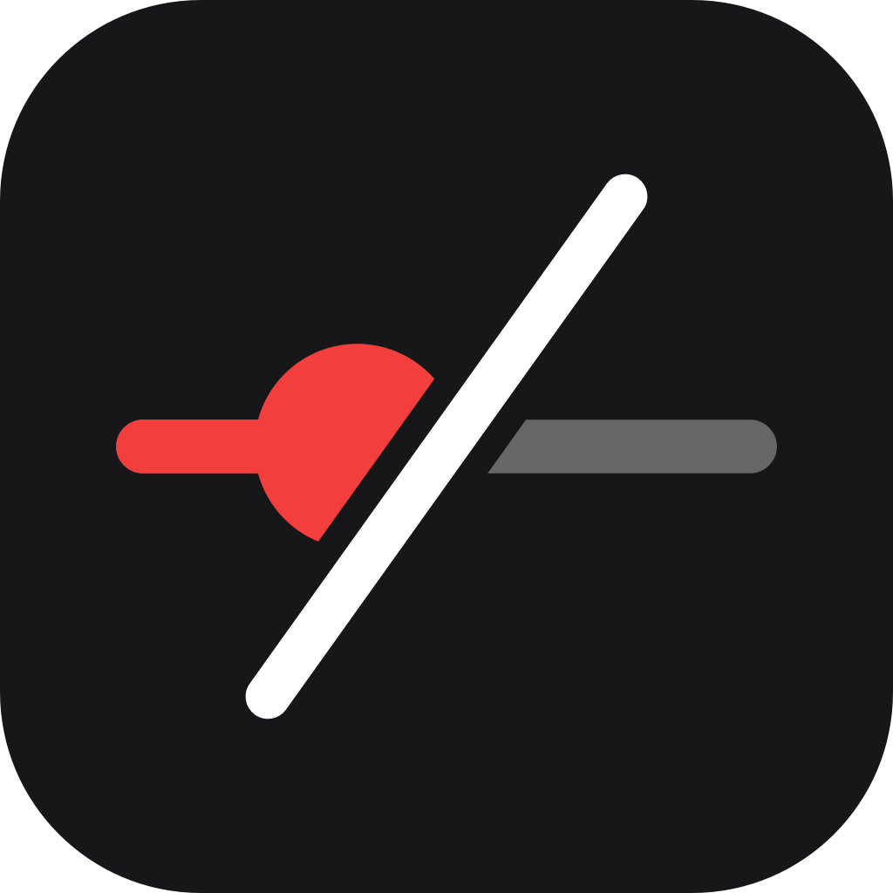

# YTHideProgress

Tweak for the YouTube app that hides the progress bar while you are not using it.

- **Portrait:** the thin progress line under the video goes away while the player controls are hidden, also for live streams and for vertical videos in fullscreen. Tap the video and the seek bar fades in with the controls and the time, then fades out with them; a paused video keeps it. Coming back to YouTube from picture in picture while the video plays, nothing pops up over it.
- **Landscape** (off by default): with **Hide in Landscape**, the same in landscape and fullscreen.
- **Hide With Controls** (off by default): the bar and the time stay hidden even while the controls are shown, in each orientation whose switch is on.
- **Miniplayer:** the line along the bottom of the floating miniplayer is hidden.
- **Thumbnails:** with **Hide Watched Bar**, the red bar showing how much of a video you watched is removed from thumbnails (home, search, watch next, history, playlists). **Hide Video Length** (off by default) also removes the length badge in their corner; badges without a time, such as LIVE or Mix, stay.
- **System Players** (jailbreak only, off by default): loads the tweak into SpringBoard and MediaRemoteUI, for the picture in picture and Now Playing options below. It takes effect after a respring, which the switch offers (**Respring Now** or **Respring Later**). While it is off, those options are greyed out and nothing outside YouTube is hooked. If SpringBoard crashes twice in a row soon after loading it (for example after an iOS or YouTube update the tweak doesn't know yet), System Players pauses itself and its description says so; turn it off and on to try again.
- **Picture in picture** (with System Players), two switches:
  - **Hide Picture in Picture Controls:** when you leave YouTube and picture in picture starts, its controls stay hidden instead of showing for a few seconds. Tap the window to show them.
  - **Hide Picture in Picture Bar:** the progress bar is left out of the picture in picture controls whenever they show (a tap, a paused video); the buttons stay. Takes effect the next time picture in picture starts.

  Picture in picture from other apps is not changed.
- **Now Playing** (with System Players): with **Hide in Now Playing**, the media players on the Lock Screen and in Control Center (and the Dynamic Island's expanded player) leave out the progress bar and the times while YouTube plays, and get shorter (on iOS 14 the row is hidden but the player keeps its height). Other apps' players are not changed.

- **Channel filter:** **Channel Filter** chooses which channels' videos the tweak applies to: all channels, only the listed ones, or all except the listed ones. It covers the player, the miniplayer, picture in picture, Now Playing and thumbnails.
  - **Adding channels:** use **Hide progress for this channel** / **Show progress for this channel** in a video's ⋯ menu (also under More actions below the video), or hold the player button. The item isn't shown while the filter is set to all channels.
  - **Channels** in the settings lists them with their pictures; swipe one to remove it.
  - Channels are matched by their ID, read from each video's data, so the filter works in any language and keeps working when a channel is renamed.
  - **Collaboration videos** (several channels): **Include Collaborators** (on by default) counts such a video as listed when any of its channels is listed. Whatever that switch says, the video's menu item (**Progress by channel…**) and holding the player button open a list of its channels, with each one's picture, name and whether its videos' progress is hidden or shown; pick one to add it or take it off.
  - Changing a channel of the playing video also clears the player button's choice for that video, so the list decides again.

Each one has its own switch in YouTube's settings, in the YTHideProgress section, under an **Enabled** switch that turns all of them on or off. All are on after install, except Hide With Controls, Hide Video Length and System Players. Without the jailbreak part (sideloaded), the System Players, picture in picture and Now Playing switches are not shown.

**Player button:** with [YTVideoOverlay](https://github.com/PoomSmart/YTVideoOverlay) installed, a button with the tweak's progress bar icon hides or shows the progress for the playing video only, whatever Enabled, the orientation switches and the channel filter say (crossed out while it's hidden). The choice lasts until YouTube is closed. It also applies to that video in the miniplayer, picture in picture and Now Playing. Hold it to add or remove the video's channel. Switch it off with **Player Button** in the YTHideProgress settings; choose top or bottom bar under Video Overlay. Without YTVideoOverlay there is no button and everything else works.

## Install

**Jailbroken (rootless, roothide or rootful), iOS 14 and later:** add the source **https://goldenappleguy.github.io/repo/** in Sileo (or your package manager) and install YTHideProgress. Or install the `.deb` for your jailbreak from the [releases](../../releases):

| Package | Jailbreak |
|---|---|
| `iphoneos-arm64` | rootless (Dopamine, palera1n rootless) |
| `iphoneos-arm64e` | roothide |
| `iphoneos-arm` | rootful |

**Sideloaded YouTube (no jailbreak):** inject `YTHideProgress.dylib` from the [releases](../../releases) into your YouTube IPA with your usual tool, as you would YTLite or YouPiP. Everything inside YouTube works: the player, the miniplayer, thumbnails, the channel filter and the player button. The picture in picture and Now Playing options need the jailbreak part, so those players behave as usual. If the dylib is in the IPA and the jailbreak package is installed too, only one copy runs.

## Tested

YouTube 20.42.3 on iOS 17.0 (rootless), with YTLite, YouPiP and YouGroupSettings installed: regular videos, live streams, vertical videos in fullscreen, the miniplayer, and picture in picture started by leaving the app. Shorts are not changed. Other versions may work: if YouTube renames a part the tweak looks for, that option stops working and the app keeps running.

## How it works

**Portrait.** YouTube keeps the bar (`YTModularPlayerBarView`) fully visible when the controls fade, and resets its opacity itself now and then. The tweak multiplies its own factor into every opacity YouTube sets. That factor follows the time row above the bar (the container's `_peekableView`), which YouTube fades in and out with the controls in `setPeekableViewVisible:` / `updatePeekableViewVisibility`; the factor changes inside the same animation, so the bar shows exactly when the time does. It never changes the bar's hidden state, which YouTube uses for ads. Portrait and landscape are told apart by the window's shape, which is right even while a rotation is still going on.

Coming back from picture in picture while the video plays, YouTube shows the time row, the bar and the fullscreen button, but none of the other controls, while the app is still in the background, and hides them 2 seconds later (`animatePlayerControlsToHidden:YES` with a 2-second delay). The tweak keeps those hidden until then. A paused video gets no such hide and shows all its controls.

**Hide With Controls** keeps the time row at zero and the bar's factor at zero in portrait.

**Miniplayer.** The same opacity factor on `YTWatchFloatingMiniplayerProgressBarView`, kept at zero while the option is on.

**Channel filter.** The player's channel is `playerResponse.playerData.videoDetails` (`channelId`, `author`) of `YTPlayerViewController`, read when a video starts and when the controls show. A cell's channel comes from its data, once per cell: playlist and history cells have a renderer behind `entry` whose byline runs link the channels (the first run's text, and each browse endpoint's `browseId`); Elements cells (home, search, watch next) keep a `YTIElementRenderer` on their cell controller (the cell node's `_parentResponder`), mostly binary, where the channel's link is its ID ("UC" and 22 characters) followed by its handle URL, found in the message's text form whatever the language. A collaboration video's other channels are the other channel links in the same data (browse endpoints, `browseId` is field 2); for the player they come from the watch page's data (`-[YTWatchNextViewController loadWithResponse:]`: the response's player overlay heading, `playerOverlays.playerOverlayRenderer.videoDetails.elementRenderer`, kept per video ID from `currentVideoEndpoint`). Channels are matched by ID; the name only when one side has no ID. The name from the cell's label is kept as a fallback, and channels added by name get their ID and picture when one of their videos shows. The video menu is a `YTDefaultSheetController`; the item is added before it presents, for the video cell its source view is in or the watch page's More actions button. Picture in picture and Now Playing get the result through the shared notify state.

**Picture in picture.** The controls are drawn by SpringBoard (Pegasus), not by YouTube. When picture in picture starts, Pegasus calls `-[PGControlsContainerView _setPrefersControlsHidden:NO animated:YES]` right after `notePictureInPictureStartedAutomatically:` to show them for a few seconds. For YouTube, the SpringBoard part turns that first call into "stay hidden". A tap makes the same call later and works as usual. The progress bar in those controls is a `PGProgressIndicator`, kept hidden while its switch is on. The switch is read from YouTube's own preferences file, since the settings live in the app.

**Thumbnails.** Two kinds of video cells. Elements cells (home, search, watch next): the thumbnail is an `_ASDisplayView` with the identifier `eml.thumbnail`; the watched bar is an unnamed subview as wide as the thumbnail, 3 pt tall, on its bottom edge, and the length badge is `eml.timestamp`. Native cells (history, playlists): a `YTProgressView` next to `id.ui.video.thumbnail.view`, and a `YTBadge` with the identifier `id.time.status.overlay.badge`. The tweak hides those when they are laid out or come back on screen, and shows them again when the option is switched off.

**Now Playing.** The Lock Screen player is drawn by MediaRemoteUI, not SpringBoard, so the jailbreak part loads there too; Control Center's is in SpringBoard. The Dynamic Island's expanded player is `MRUActivityNowPlayingView` (in MediaRemoteUI) with no such switch: the tweak hides its scrubber row, moves what's below it up and lowers `preferredHeightForBottomSafeArea` by the row's height. `MRUNowPlayingView` has a `showTimeControlsView` switch; the tweak keeps it off while the playing app (`controller.metadataController.bundleID` of its view controller; on iOS 14, which has neither the controller nor the switch, the view controller's `endpointController.bundleID`) is YouTube, so the player lays out without the row. On iOS 14 the row is only hidden. MediaRemoteUI's sandbox can't read YouTube's settings, so YouTube publishes the switch as a notify state (`com.goldenappleguy.ythideprogress.state`). When it changes, the open players apply it at once: the time row is put back or left out and the player's view controller tells its host the size changed, so the Lock Screen and Notification Center platter grows or shrinks with it.

**System Players.** The jailbreak part loads into SpringBoard and MediaRemoteUI, but only installs its hooks if System Players was on when SpringBoard started. A crash guard keeps a small file in `/var/mobile/Documents/YTHideProgress/`: a SpringBoard restart counts when it comes within 5 minutes of the hooks going in and SpringBoard left a crash report (a hang leaves one when the watchdog ends it), so ordinary resprings don't; two in a row pause the hooks until the switch is turned on again. SpringBoard reads YouTube's settings only once it has finished launching: finding YouTube's container goes through LaunchServices, which deadlocks SpringBoard if asked while tweaks are still loading (seen on iOS 15 with Dopamine). YouTube shares the switch's value through a second notify name (`com.goldenappleguy.ythideprogress.respring`), since its preferences file can be written late, and posts that name for **Respring Now**. SpringBoard resprings only when the value differs from what it loaded. MediaRemoteUI follows what SpringBoard loaded and quits, to be started again, when a respring changes it.

## Build

Needs [Theos](https://theos.dev). `./build.sh` builds all three packages into `packages/`, plus `YTHideProgress.dylib` for sideloading. roothide needs roothide's Theos fork in `~/theos-roothide` (or `$THEOS_ROOTHIDE`). A single rootless package: `make package`.

## License

MIT, see [LICENSE](LICENSE).
